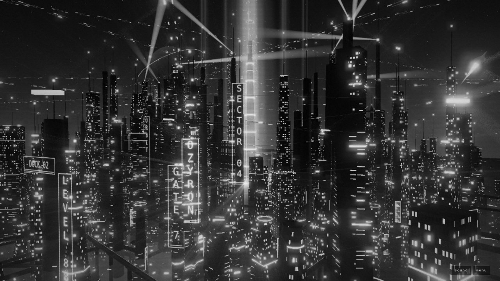
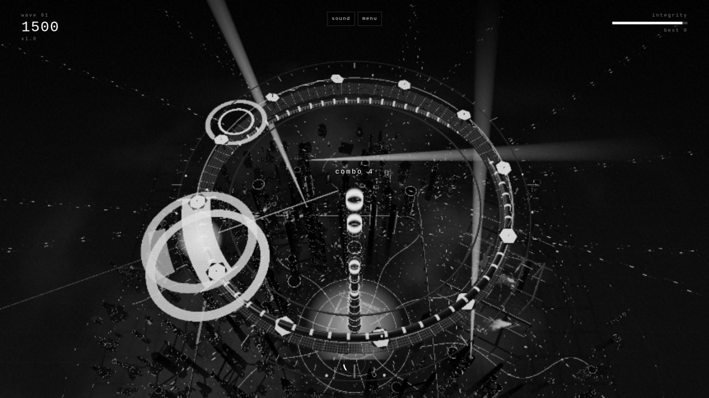
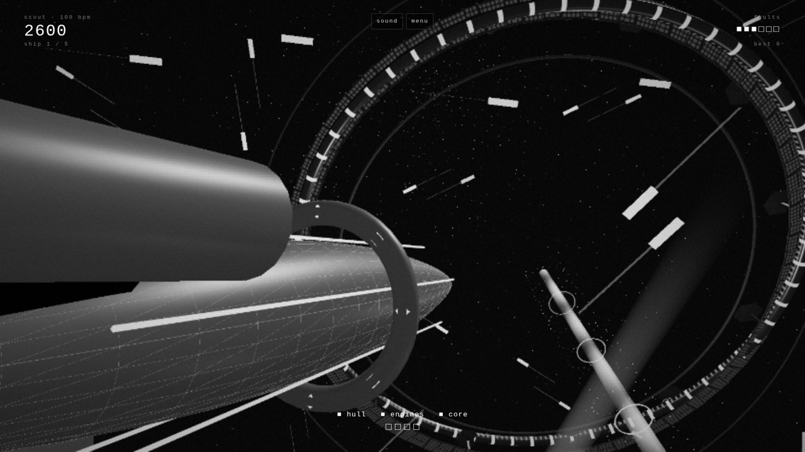

# Ozyron

**[Launch Ozyron →](https://kxz0tn.github.io/ozyron/)**

Ozyron is a real-time 3D cyberpunk city that runs in the browser. Megatowers, sky rail, drones, an orbital energy ring, rain on wet streets and a full day/night cycle — all generated in code. The city hosts a small set of games built on a shared rhythm engine.



## Games

### Beam Keeper
Keep the city's energy beam locked on the orbital ring. Rotate to aim at incoming collectors and fire on the beat. Misses drain grid integrity and darken whole sectors of the skyline. Survive four waves and the boss surge.



### Shipyard Builder
Run the orbital shipyard's assembly line. Parts arrive on the belt in time with the music; weld each one into place on the beat, avoid wrong parts, then nail the countdown to launch the finished ship through the ring. Clean runs unlock larger ship classes.



### Explore and Photo
Fly freely around the city, or use photo mode with camera presets to frame your own shots.

## Controls

| Action | Keyboard | Gamepad | Touch |
| --- | --- | --- | --- |
| Rotate / aim | A / D, ← / → | left stick, d-pad | drag |
| Fire / weld / launch | Space, Enter | A | fire button |
| Pause | Esc, P | Start | menu button |
| Restart | R | Y | pause menu |

Every key can be remapped in **settings**. Input is timestamped and judged against the audio clock, with input buffering, a short coyote window on aim, and a latency calibration tool so timing feels right on any device. Each game has a short tutorial on first play.

## Quality tiers

The tier is picked automatically from your device and can be changed in settings, or forced with `?q=low|med|high|ultra`.

| Tier | What you get |
| --- | --- |
| low | lean city for phones and older laptops: no bloom, light rain, no reflections |
| med | bloom, light shafts, denser city and traffic |
| high | soft shadows, wet-street reflections, volumetric light |
| ultra | maximum density, full-resolution volumetrics |

## Running locally

No build step. Serve the folder with any static server:

```
python3 -m http.server 8000
```

then open http://localhost:8000. `?mode=beamkeeper|shipyard|explore|photo` jumps straight into a module.

## Structure

- `js/core/` — settings and tiers, module registry, input, WebAudio synth and music, rhythm clock, camera rig, ui
- `js/city/` — day/night, atmosphere, transit, signs, rain, docks, energy effects
- `js/games/` — Beam Keeper, Shipyard Builder
- `js/modes/` — explore, photo

New games register themselves through `js/core/registry.js` and appear in the menu automatically.

## Credits

Design and code by **kxz0tn**, with help from **Flux** (Grok Bot). All geometry, textures, shaders, music and sound effects are original and generated at runtime. The only third-party code is [three.js](https://threejs.org) (MIT) — see [THIRD_PARTY_NOTICES.md](THIRD_PARTY_NOTICES.md).

## Licence

[MIT](LICENSE) © 2026 kxz0tn
